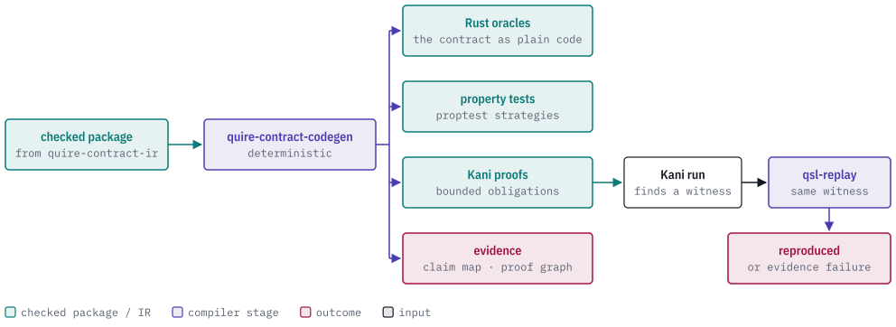
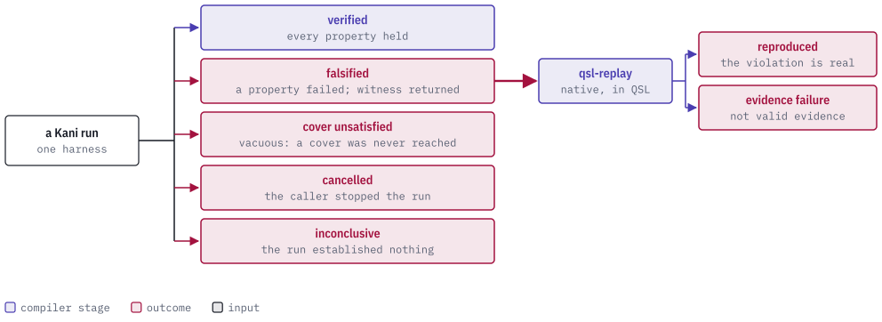
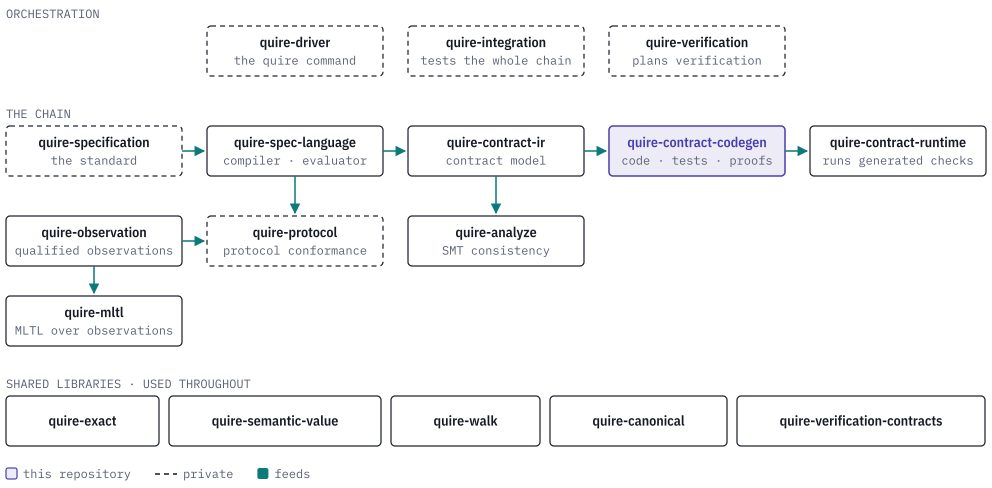

# Quire Contract Codegen

[](https://discord.gg/k8DVhuYBR2)

A contract says what an operation promises: *the result never exceeds the
balance*, *two records are equal when every field is equal*. To trust that
promise you want it checked in several independent ways: as plain code you can
run, as property tests over many inputs, and as a proof over every input within
stated bounds. This library is the part that writes all of those from the one
contract.

It takes a checked contract package (produced by
[quire-contract-ir](https://github.com/agent-ix/quire-contract-ir)) and
generates Rust oracles, proptest strategies and test harnesses, Kani proof
harnesses, and the evidence records that tie each output back to the clause it
came from. Generation is deterministic: the same package always gives the same
bytes. So the layer above never hand-writes a test or a proof that could drift
from the contract, and when a proof fails the counterexample is replayed through
QSL to find out whether it is a real violation.

<picture>
  <source media="(prefers-color-scheme: dark)" srcset="docs/images/hero-dark.svg">
  
</picture>

> **Status: public prerelease.** The public API is not stable, `Cargo.toml`
> sets `publish = false`, and nothing here is a release approval. Expect
> breaking changes.

Codegen never guesses. A clause it cannot lower becomes a typed refusal in the
claim map, not a silently skipped test, and a counterexample that QSL cannot
reproduce is reported as an evidence failure, never as a pass or a fail.

## What the replay step looks like

Codegen is a Rust library with no command line, and building its inputs takes a
checked package, so there is no three-line quick start. The smallest
self-contained piece is the replay step: take the values Kani found, run them
through a QSL function that mirrors the clause, and see whether QSL agrees the
clause is violated. These excerpts are from
[`tests/it/skeleton_spine.rs`](tests/it/skeleton_spine.rs), which runs in the
default test lane:

```rust
const VIOLATING_TWIN: &str = "balance_pre + amount_current";
const FUNCTION: &str = "balance_never_grows";

fn native_source(post_balance: &str) -> String {
    format!(
        "language \"ix:native\" edition \"1-draft\";\n{PROFILE}\
         function {FUNCTION} using v(amount_current: Int[0, 1000], balance_pre: Int[0, 1000]): \
         Boolean pure {{ {post_balance} <= balance_pre }}\n"
    )
}

#[test]
fn tc_026_a_falsifying_input_replays_through_qsl_to_the_same_violation() {
    let result =
        replay_against(&native_source(VIOLATING_TWIN), &values(1, 5)).expect("the replay settles");
    assert_eq!(
        result.settlement(),
        WitnessSettlement::ReproducedWithEvaluatedWitness
    );
    assert_eq!(result.category(), Category::Violation);
}
```

`replay_against` calls `replay_falsification` with the decoded witness values
(`amount_current = 1`, `balance_pre = 5`). The same file shows the opposite
case: a healthy twin does not reproduce the violation, so QSL settles
`inconclusive` and names both verdicts instead of repairing the disagreement.

## What it generates

| Output | Entry points | What you get |
| --- | --- | --- |
| Rust oracles | `generate_exact_scalar_oracles`, `generate_composite_equality_oracles`, `generate_exact_function_oracles` | A small Rust crate (`Cargo.toml`, `src/lib.rs`) that computes each contract operation exactly, plus a claim map saying which clause each function came from or why it was refused. |
| Property tests | `generate_tristate_harness`, `generate_bound_strategy`, `generate_enum_strategy`, `generate_i64_strategy` | Proptest strategies and a harness that records every case as accepted, rejected by the precondition, or discarded, with the accounting kept. |
| Kani proofs | `negotiate_kani_obligations`, `generate_kani_bundle`, `generate_state_frame_obligations`, `generate_bounded_kani_corpus_case` | Kani harnesses with explicit bounds, and a proof-dependency graph that says whether the proof is ready, conditional or incomplete. |
| Running Kani | `execute_kani_obligation`, `execute_kani_obligations`, `classify_kani_run` | The run's outcome, classified (see below). |
| Replay | `decode_falsification`, `replay_falsification`, `replay_counterexample` | A Kani counterexample decoded and re-run in QSL. |
| Evidence | `analyze_bound_coverage`, `parse_llvm_coverage`, `classify_clause` | Observations of which bounded cases and clauses a test run reached. |
| Routing | `negotiate_contract_package`, `generate_routed` | Settles which backend takes each item of a package, then generates for it. |
| Publishing | `write_bundle_atomic` | Writes a generated bundle to disk all at once or not at all. |

Generated Rust depends only on
[quire-contract-runtime](https://github.com/agent-ix/quire-contract-runtime) and
the customer's own types.

### How a Kani run ends

<picture>
  <source media="(prefers-color-scheme: dark)" srcset="docs/images/outcomes-dark.svg">
  
</picture>

A *cover unsatisfied* run is vacuous: nothing failed, but the contract's bounds
or precondition left no case to check, so the proof says nothing. Codegen reports
it separately instead of calling it verified.

### Output schemas

Each generated artifact is a path and its contents. The documents under
[`schemas/`](schemas/) are the output contracts:

| Schema | Describes |
| --- | --- |
| `generated-rust-oracle-v1.schema.json`, `oracle-source-map-v1.schema.json` | Generated oracle Rust and its source map. |
| `generated-rust-kani-v2.schema.json`, `kani-proof-graph-v2.schema.json` | Generated Kani Rust and its proof graph. |
| `kani-corpus-proof-graph-v1.schema.json` | The bounded Kani corpus proof graph. |
| `bound-coverage-observations-v1.schema.json` | Bound coverage observations. |

## The Quire ecosystem

Codegen is a backend: it sits between the language layer and the tools that run
what it writes.

<picture>
  <source media="(prefers-color-scheme: dark)" srcset="docs/images/ecosystem-dark.svg">
  
</picture>

It depends on [quire-contract-ir](https://github.com/agent-ix/quire-contract-ir)
(the checked package and its model types),
[quire-contract-runtime](https://github.com/agent-ix/quire-contract-runtime)
(what generated code builds on),
[quire-exact](https://github.com/agent-ix/quire-exact),
[quire-canonical](https://github.com/agent-ix/quire-canonical) (identity
encoding), and
[quire-spec-language](https://github.com/agent-ix/quire-spec-language) for one
crate only, `qsl-replay`. Its tests also use
[quire-verification-contracts](https://github.com/agent-ix/quire-verification-contracts).
It is used by quire-driver (private) and quire-integration (private).

## Building and testing

The Rust version is pinned in `rust-toolchain.toml` (1.98.1). The real-Kani tests
need `make tools` once per machine, and the full gate reads checked-package
fixtures from a `quire-specification` (private) checkout:

```bash
make ci QSPEC_DIR=/path/to/quire-specification
```

`make ci` runs formatting, specification validation, Clippy, the tests under the
minimum supported Rust version, licence and source checks (`cargo deny`), the
unsafe-code audit, and the API documentation build. `make kani` runs the slower
real-Kani lane. CI workflows are manual-only, so run the gate locally before
opening a pull request.

The requirements, architecture and decisions are in [`spec/`](spec/) and
[`plan/`](plan/). See [CONTRIBUTING.md](CONTRIBUTING.md) and
[AGENTS.md](AGENTS.md). Contributions need the [CLA](CLA.md). Agent-assisted
contributions are welcome and held to the same traceability and testing
standard, with a human deciding every release.

## Licence

Licensed under the GNU Affero General Public License, version 3 or (at your
option) any later version (`AGPL-3.0-or-later`). See [LICENSE](LICENSE).

Rust source that the generator emits carries its own
`SPDX-License-Identifier: MIT OR Apache-2.0` header, so generated code can be
used under those terms; the header describes the output, not this crate.
